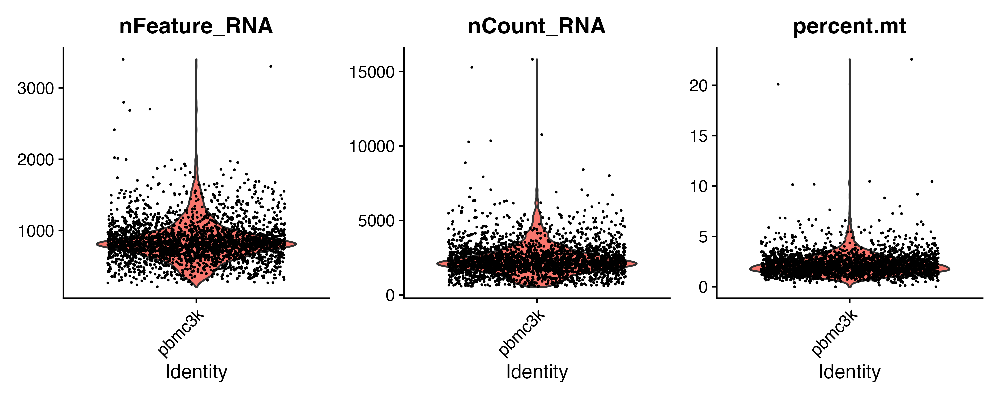
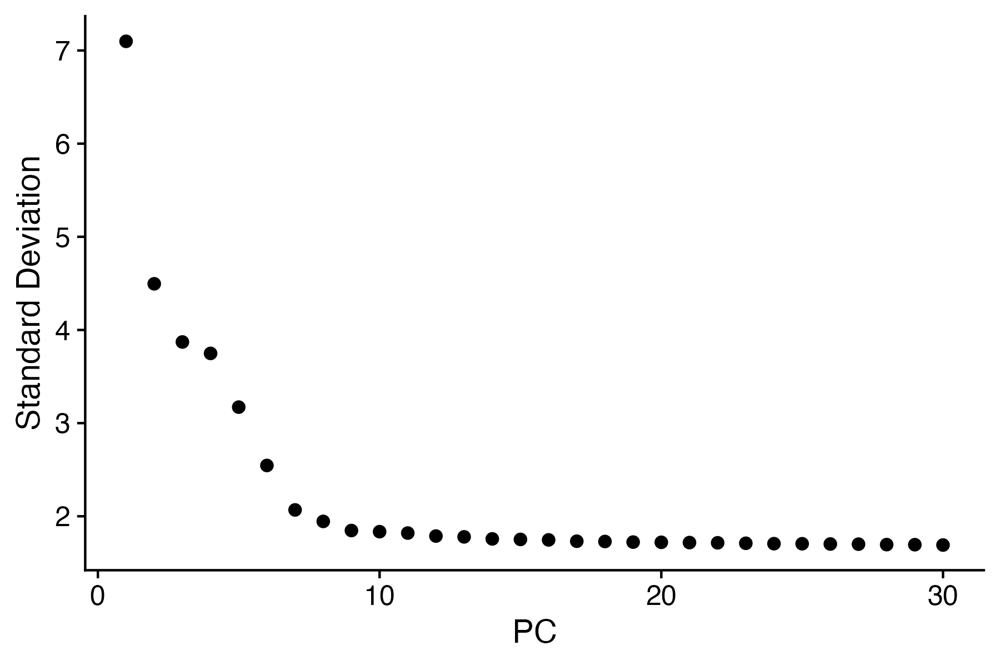
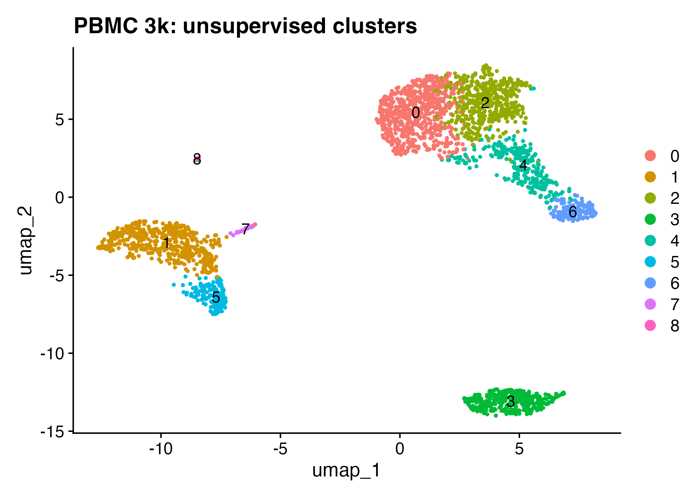
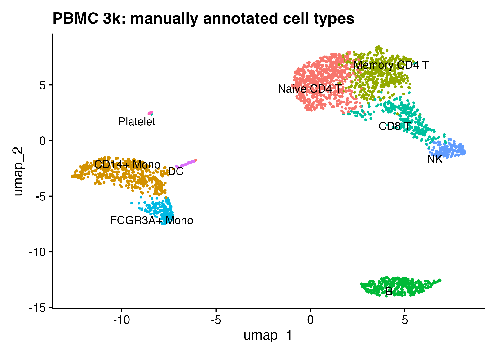
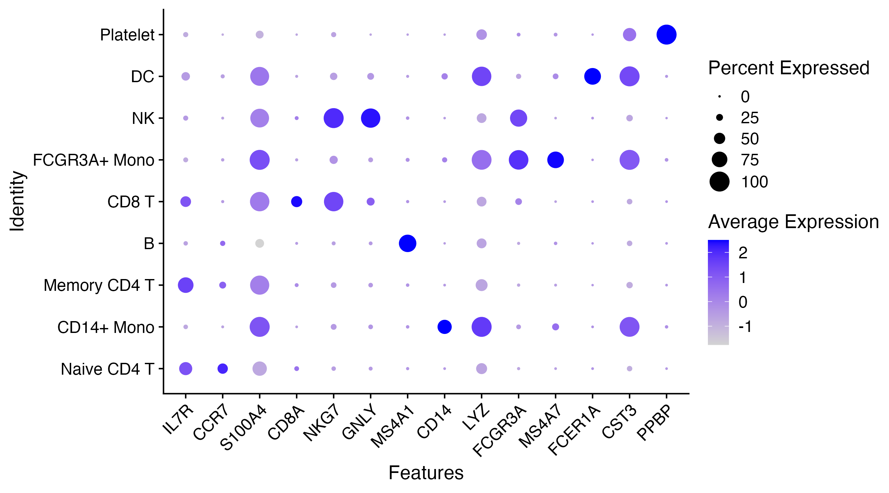
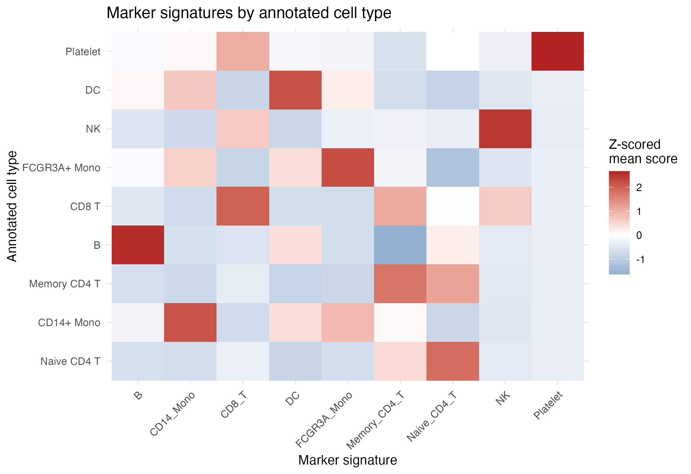

# Single-cell RNA-seq of human peripheral blood mononuclear cells (PBMCs): clustering and annotation (Seurat)

## Question
Can the immune cell types in a standard public PBMC dataset be recovered by unsupervised clustering, annotated from marker genes, and checked against independent marker signatures?

## Data
10x Genomics PBMC 3k (peripheral blood mononuclear cells from a healthy donor, 2,700 cells). This is a widely used tutorial dataset, so this project is not a new finding.

## Methods
- QC with Seurat: kept cells with 200-2,500 detected genes and under 5% mitochondrial reads (2,700 to 2,638 cells).
- Log-normalisation, 2,000 variable genes, PCA, and graph-based clustering (10 PCs, resolution 0.5), giving 9 clusters; UMAP for visualisation.
- Cluster markers by Wilcoxon test (FindAllMarkers); cell types assigned manually from canonical markers.
- Consistency check: each cell scored for 5-gene marker signatures per cell type (AddModuleScore).

## Quality control

*Distributions before filtering (2,700 cells). Cells with 200-2,500 genes and under 5% mitochondrial reads were kept.*

*The curve flattens after roughly 8-10 components; the first 10 principal components were used for clustering.*

## Results
- Nine clusters corresponding to naive CD4 T, memory CD4 T, CD8 T, NK, B, CD14+ monocytes, FCGR3A+ monocytes, dendritic cells and platelets.
- 74% of cells scored highest for the signature matching their label. Agreement was near-complete for B, NK, DC, platelets and monocytes (91-100%) and lower for T-cell subsets (47-66%), which share many genes.

*Nine unsupervised clusters (numbers are cluster IDs).*

*The same clusters labelled by cell type.*

*Canonical marker expression per annotated cell type.*

*Mean marker-signature score per annotated cell type (z-scored across cell types).*

## Limitations
- Standard, small dataset; no novel biology claimed.
- Manual annotation, with some overlap between T-cell subsets.
- The signature check shares genes with those used for annotation, so it tests consistency and is not independent validation. Short signatures scored per cell are noisy for low-expressed genes.
- Automated reference annotation (SingleR) was not used.
- Clustering parameters (10 PCs, resolution 0.5) were chosen by standard practice, not tuned.

## Reproduce
Run `analysis.R` in R. The data download automatically. Package versions are in `results/sessionInfo.txt`.
